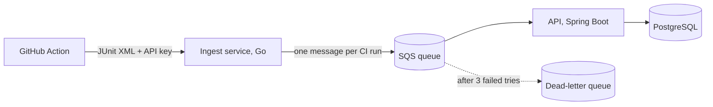

# FlakeSince

[](https://github.com/TheStrawberry-09/flakesince/actions/workflows/api.yml)
[](https://github.com/TheStrawberry-09/flakesince/actions/workflows/ingest.yml)

Find flaky tests in CI and the commit they started at. Free and self-hosted.

## The problem

A flaky test passes and fails on the same code. Teams lose time re-running builds and slowly stop trusting red builds. At Atlassian, about 15% of Jira backend test failures are flaky, and the re-runs waste over 150,000 hours of developer time each year ([Atlassian Engineering](https://www.atlassian.com/blog/atlassian-engineering/taming-test-flakiness-how-we-built-a-scalable-tool-to-detect-and-manage-flaky-tests)).

Most free tools tell you that a test is flaky today. FlakeSince keeps the pass/fail history of every normal CI run, so it can also estimate **since which commit** a test has been flaky, without re-running anything.

## Status: v0.1.0

- ✅ Upload JUnit XML from GitHub Actions (Gradle/Maven Surefire, pytest, go-junit-report)
- ✅ One API key per upload source, stored only as a SHA-256 hash
- ✅ A queue between ingestion and storage, with retries and a dead-letter queue
- ✅ Pass/fail history per test through the REST API
- ⏳ Next: flaky test detection, "flaky since commit X" estimates, a dashboard, a hosted demo

## How it works



- **Ingest (Go)** checks the API key, parses the JUnit XML and puts the run on the queue. It answers `202 Accepted` as soon as the run is safely queued, even if the API is busy or down.
- **API (Spring Boot)** reads the queue and saves each run exactly once, even when the queue delivers a message twice. It serves the REST API, with docs at `/scalar`.
- **Queue:** Amazon SQS in production; [ElasticMQ](https://github.com/softwaremill/elasticmq) locally, so no AWS account is needed for development.

Design decisions are recorded in [`docs/decisions`](docs/decisions).

## Use it in GitHub Actions

```yaml
- name: Upload test results to FlakeSince
  if: always()   # upload even when tests fail
  uses: TheStrawberry-09/flakesince/action@v0
  with:
    url: ${{ secrets.FLAKESINCE_URL }}
    api-key: ${{ secrets.FLAKESINCE_API_KEY }}
    paths: '**/build/test-results/**/*.xml'   # default; change for your build tool
```

A failed upload only adds a warning, so FlakeSince never turns your CI red. Set `fail-on-error: 'true'` to change that.

## Run it locally

Requirements: Docker and JDK 25.

```bash
git clone https://github.com/TheStrawberry-09/flakesince.git
cd flakesince
cp .env.example .env            # then set your own passwords in .env
docker compose up -d            # PostgreSQL + ElasticMQ

cd api && ./gradlew bootRun     # API on :8080, creates the tables
```

In a second terminal, let the ingest service log in to the database (use the password from `DATABASE_URL` in `.env`), then start it:

```bash
docker exec -it flakesince-postgres psql -U flakesince \
  -c "ALTER ROLE ingest_reader WITH LOGIN PASSWORD 'your-password';"

cd ingest
docker run --rm -v "$PWD:/src" -w /src -p 8081:8081 --env-file ../.env golang:1.25 go run .
```

Open http://localhost:8080/scalar, create a project and an API key, and send a test file:

```bash
curl -X POST -H "Authorization: Bearer fs_live_..." \
  -H "X-Commit-Sha: abc123" -H "X-Branch: main" -H "X-Run-Id: 1" \
  --data-binary @ingest/testdata/pytest.xml http://localhost:8081/ingest
```

## License

[Apache-2.0](LICENSE)